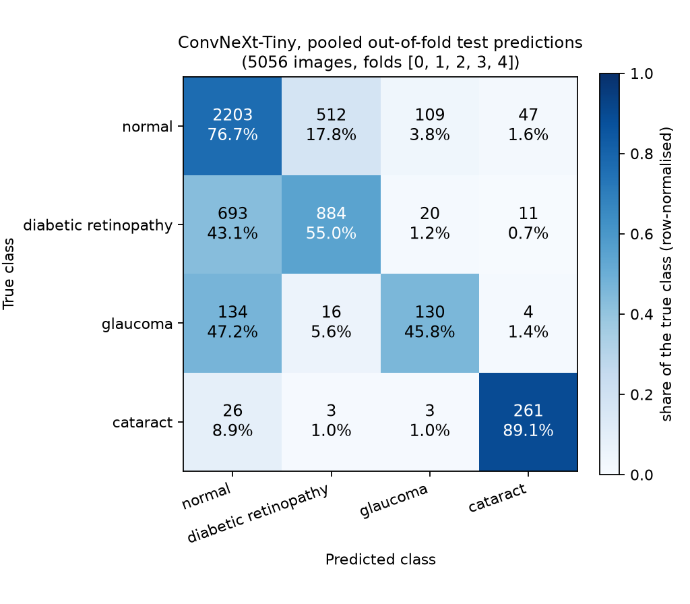

# Ophthalmic Disease Detection Using Deep Learning

Four-class fundus screening (normal, diabetic retinopathy, glaucoma, cataract) with an ImageNet-pretrained **ConvNeXt-Tiny**, evaluated on a patient-disjoint split of ODIR-5K, with Grad-CAM explanations and a local screening web app.

> Academic prototype. Not a medical device, not a diagnostic tool, not clinically validated.

## Overview

This is the final version of the PBL project. The original project used ImageNet ResNet50. A controlled comparison of six backbones on identical patient-disjoint folds selected ConvNeXt-Tiny (see [docs/MODEL_SELECTION.md](docs/MODEL_SELECTION.md)), and this project rebuilds the pipeline around it: model, training, evaluation, Grad-CAM, inference and the app all use the one checkpoint named in `configs/config.yaml`.

## Model

| | |
|---|---|
| Architecture | ConvNeXt-Tiny (torchvision) |
| Pretrained weights | `ConvNeXt_Tiny_Weights.IMAGENET1K_V1` (ImageNet-1k) |
| Frozen | stem and stages 1 to 3 (`features[0:6]`), 12.35 M parameters |
| Trained | stage 4 (`features[6:8]`) + LayerNorm(768) + Linear(768, 4), 15.48 M parameters |
| Input | 224 x 224 RGB, ImageNet mean / std |
| Checkpoint | `checkpoints/convnext_tiny/best_model.pth` |

## Dataset

ODIR-5K (Li et al. 2021), four single-label classes: **5,056 images from 2,909 patients** after duplicate removal. Normal 2,871, diabetic retinopathy 1,608, cataract 293, glaucoma 284. The images are not redistributed; see [data/README.md](data/README.md).

The split is the original project's patient-disjoint 5-fold split, reused unchanged: both eyes of a patient are always in the same fold, and 0 patients appear in two folds (asserted before every training run).

## Pipeline

```text
Fundus image
     |
Preprocessing        resize to 224 x 224 (bilinear, no crop), ImageNet normalisation
     |
ConvNeXt-Tiny        frozen stem + fine-tuned stage 4 + LayerNorm + Linear
     |
Disease prediction   normal / diabetic retinopathy / glaucoma / cataract
     |
Confidence           temperature-scaled softmax
     |
Grad-CAM             heatmap from the last stage (optional)
     |
Result               accept, or defer to a clinician (low confidence or contradicting referral letter)
```

## Results

Pooled out-of-fold test predictions: each of the five fold models predicts its own held-out fold, so all 5056 images (2909 patients) are scored once by a model that never saw the patient. Model selection used the validation fold only. Measured on this machine by `python scripts/evaluate.py`.

| Metric | ConvNeXt-Tiny |
|---|---:|
| Accuracy | 0.6879 (95% CI 0.6744 to 0.702) |
| Precision (macro) | 0.6624 |
| Recall / Sensitivity (macro) | 0.6664 |
| Specificity (macro) | 0.8537 |
| F1-score (macro) | 0.6630 (95% CI 0.6442 to 0.6812) |
| AUROC (macro, one-vs-rest) | 0.8618 |
| AUPRC (macro, one-vs-rest) | 0.7170 |
| Parameters | 27.82 M total, 15.48 M trained |
| Inference time | 124.6 ms per image (laptop CPU, batch 1) |

Per class:

| Class | Images | Precision | Recall / Sensitivity | Specificity | F1 | AUROC | AUPRC | TP | TN | FP | FN |
|---|---:|---:|---:|---:|---:|---:|---:|---:|---:|---:|---:|
| normal | 2871 | 0.7209 | 0.7673 | 0.6096 | 0.7434 | 0.7623 | 0.7753 | 2203 | 1332 | 853 | 668 |
| diabetic retinopathy | 1608 | 0.6247 | 0.5498 | 0.8460 | 0.5848 | 0.8006 | 0.6929 | 884 | 2917 | 531 | 724 |
| glaucoma | 284 | 0.4962 | 0.4577 | 0.9723 | 0.4762 | 0.8989 | 0.4784 | 130 | 4640 | 132 | 154 |
| cataract | 293 | 0.8080 | 0.8908 | 0.9870 | 0.8474 | 0.9853 | 0.9216 | 261 | 4701 | 62 | 32 |



More figures: [ROC](results/roc/roc_curve.png), [precision-recall](results/pr/precision_recall_curve.png), [training curves](results/training/training_history.png), [Grad-CAM overview](results/gradcam/gradcam_overview.png).

### The deployed checkpoint

The app serves one checkpoint, `checkpoints/convnext_tiny/best_model.pth` (the fold-0 model, fixed in the config before training). Run file by file through the real inference path on its own held-out fold (1012 images, 582 patients):

| Metric | Deployed checkpoint |
|---|---:|
| Accuracy | 0.6976 |
| Precision / Recall / Specificity (macro) | 0.7176 / 0.6546 / 0.8613 |
| F1-score (macro) | 0.6790 (95% CI 0.6334 to 0.7211) |
| AUROC / AUPRC (macro) | 0.8789 / 0.7498 |
| Glaucoma recall | 0.4107 |
| Cataract recall | 0.8136 |
| Calibration error (ECE) | 0.1106 before, 0.0202 after temperature scaling (T = 1.9582) |
| End-to-end time | 223 ms per image including file decoding (CPU) |

The cached-stem path used in training and the file-by-file path agree on 100.0% of predictions (largest probability difference 1e-06).

### Against the previous model

On the 5056 images both models predicted (same patient-disjoint folds), ConvNeXt-Tiny scores macro-F1 0.663 against 0.6421 for the original project's ResNet50. Exact McNemar test on paired correctness: ConvNeXt-Tiny right where ResNet50 was wrong on 612 images, the reverse on 544; p = 0.048724, so the difference is only borderline significant (just under the 0.05 level) and should be described as a modest improvement. McNemar tests overall correctness (accuracy), not macro-F1.

## Installation

Python 3.11. A GPU is not needed.

```bash
python -m venv .venv
.venv\Scripts\activate                 # Windows;  source .venv/bin/activate on Linux / macOS
pip install torch torchvision --index-url https://download.pytorch.org/whl/cpu
pip install -r requirements.txt
```

Tell the project where the ODIR-5K training images are (needed for training and evaluation, not for predicting on your own image):

```bash
copy .env.example .env                 # then edit ODIR_IMAGES in .env
```

## Training

```bash
python scripts/train.py --smoke        # 2-minute check of the whole code path
python scripts/train.py                # five folds; about 76 minutes of training on a laptop CPU, plus a one-off cache build
python scripts/train.py --folds 0      # only the deployed model
```

## Evaluation

```bash
python scripts/evaluate.py             # metrics, tables, confusion matrix, ROC, PR
python scripts/gradcam.py              # Grad-CAM examples
python scripts/verify_project.py       # PASS / FAIL check of the whole project
python -m pytest                       # unit tests
```

## Inference

```bash
python scripts/predict.py --image path/to/fundus.jpg
python scripts/predict.py --image path/to/fundus.jpg --gradcam heatmap.png
```

## Application

```bash
python scripts/serve.py                # then open http://127.0.0.1:8000
```

A local web app (standard library only). With the ODIR images available it pre-screens 10 held-out cases; without them it starts upload-only. Upload a fundus photograph, optionally with a referral letter image from `data/sample_referrals/`.

## Google Colab

Open `notebooks/final_results.ipynb` in Colab and run all cells: it fetches the project, installs, finds or downloads ODIR-5K, verifies it, trains, evaluates, plots, predicts and produces Grad-CAM.

## Project structure

```text
configs/config.yaml          single source of truth: model, checkpoint, data, preprocessing, training
configs/idp.yaml             referral-letter fields for the OCR module
data/                        split manifest, sample referral letters, data README (images not included)
src/models/                  ConvNeXt-Tiny definition, checkpoint save / load
src/data/                    preprocessing, split loading and leakage checks, caches
src/training/                training loop, class-weighted loss, temperature scaling
src/evaluation/              metrics, bootstrap confidence intervals, McNemar, evaluation run
src/explainability/          Grad-CAM for ConvNeXt-Tiny
src/inference/               Predictor used by the CLI, the evaluation and the app
src/app/, src/idp/           screening pipeline, web pages, case assistant, OCR and field extraction
scripts/                     train, evaluate, predict, gradcam, serve, verify_project
checkpoints/convnext_tiny/   best_model.pth (deployed)
results/                     metrics, plots, confusion matrices, ROC, PR, Grad-CAM, final results table
notebooks/                   Colab notebook
docs/                        MODEL, TRAINING, EVALUATION, DEPLOYMENT, MODEL_SELECTION
tests/                       unit tests
```

## Limitations

- **Not a medical device.** Academic prototype with no clinical validation and no regulatory clearance.
- **Modest absolute performance.** Macro-F1 is 0.6630. Glaucoma is the weakest class (recall 0.4577, F1 0.4762); the system is not a glaucoma screener.
- **One dataset.** ODIR-5K, from hospitals in China. No external test set; the original project showed the earlier model did not transfer to other image sources.
- **Small minority classes.** 284 glaucoma and 293 cataract images against 2,871 normal.
- **Training recipe held fixed, not optimised.** 224 px input, no augmentation, only the last stage fine-tuned, one seed per fold. These settings were kept identical to the original project and the comparison so results stay comparable.
- **Audit experiments were not re-run.** The leakage, duplicate, image-source and demographic analyses of the original project used ResNet50. They describe the dataset and protocol and are not repeated here.
- **Deferral rules were not re-tuned.** The confidence and agreement thresholds, and the deferral results (AURC), come from the original project's model. They have not been re-measured for ConvNeXt-Tiny.
- **Referral letters are synthetic.**
- **Grad-CAM is not validated against lesions.** There are no lesion annotations in this project.

## References

Li, N., Li, T., Hu, C., Wang, K., Kang, H. (2021). A Benchmark of Ocular Disease Intelligent Recognition. doi:10.1007/978-3-030-71058-3_11
Liu, Z. et al. (2022). A ConvNet for the 2020s. doi:10.1109/cvpr52688.2022.01167
Selvaraju, R. R. et al. (2017). Grad-CAM. doi:10.1109/iccv.2017.74
